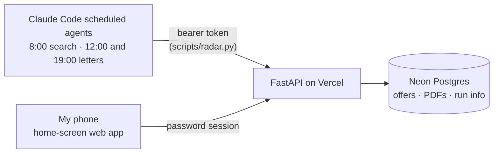

# Radar VIE

My daily radar for V.I.E. positions (the French international volunteer programme: 6 to 24 months
working abroad for a French company). Every morning an agent reads the new offers, keeps the ones
that fit my profile, scores them and lists them here. When I approve one, a one-page cover letter
is ready for me by noon or 7 pm.

**Built end to end with [Claude Code](https://claude.com/claude-code).** I designed the product, the
rules and the data model, and directed every step; Claude wrote the code, the tests and the agent
instructions, and runs the daily agents. I use it every day from my phone.

## What it does

- **8:00, morning search.** An agent reads the new V.I.E. offers, keeps the target cities and roles,
  scores each one from 0 to 100 against an explicit list of my skills (a skill is never inferred from
  another one), and emails me a summary.
- **Triage on the phone.** Each offer moves from *À trier* to *Validée* or *Passée*, then *Postulée*.
- **12:00 and 19:00, cover letters.** For every offer I approved, an agent writes a one-page PDF letter
  and attaches it to the offer.
- **Ready to apply.** The letter and the right CV open inside the app and can be saved to the phone,
  ready to attach to the application.

## Architecture



## Design choices

- **The agents can never undo my decisions.** What the agents write (title, score, skills...) is
  stored apart from what I decide (status and dates). Re-scoring a validated offer keeps it validated.
  The API enforces it and a test covers it.
- **One user, no accounts.** Argon2 password hash, signed HttpOnly session cookie, failed sign-ins
  rate-limited per IP. Changing the password signs every device out. The agents use a separate token.
- **PDFs in Postgres**, rendered in the page with PDF.js. A few dozen files of 50 to 500 KB do not
  need object storage, and an installed web app on iOS loses its session in a new tab.
- **No personal data in this repository.** Offers, letters and CVs live only in the database. The
  agents' instructions stay private too: they hold my personal criteria.

## Stack

Python 3.12, FastAPI, psycopg 3, PostgreSQL (Neon), Vercel, a plain HTML/CSS/JS front end, PDF.js, pytest.

## API

| Method and path | Who | What |
| --- | --- | --- |
| `POST /api/login`, `POST /api/logout` | anyone | open or close a session |
| `GET /api/offers`, `GET /api/offers/{id}` | owner, agent | read offers |
| `PUT /api/offers/{id}` | agent | create an offer or merge fields, never touching the decision |
| `PATCH /api/offers/{id}` | owner: status only; agent: any field | update; `null` removes a field |
| `DELETE /api/offers/{id}` | agent | remove an offer |
| `GET /api/meta/{key}`, `PUT /api/meta/{key}` | owner reads, agent writes | last run, current CV files |
| `POST /api/files?name=`, `GET /api/files/{id}` | agent uploads, owner reads | PDF letters and CVs |

Interactive docs at `/api/docs`.

## Run it locally

```bash
cp .env.example .env            # then fill in the values
createdb radar_vie && uv run python -m app.db
uv run uvicorn app.main:app --reload
uv run pytest                   # uses a throwaway local database
```

`scripts/radar.py` is the command-line client the agents use; `scripts/set_password.py` sets the
sign-in password in Vercel without it ever leaving the computer.
